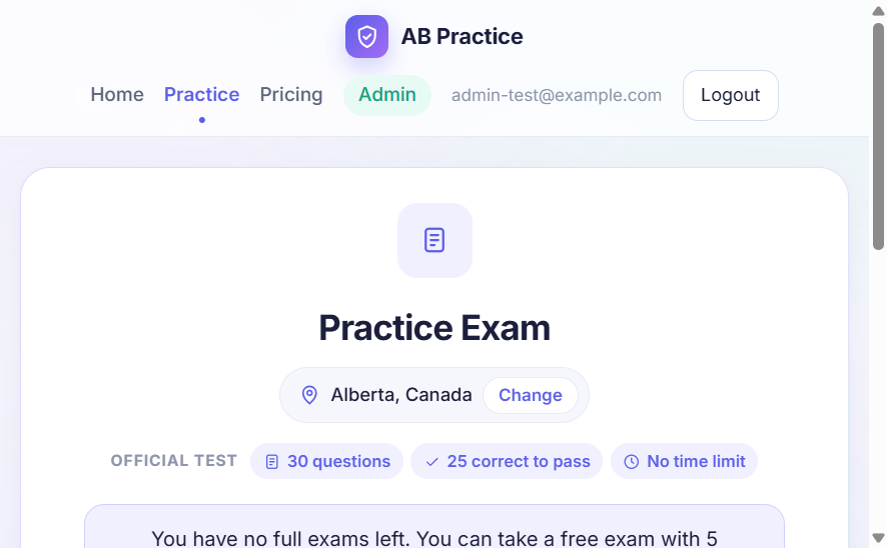
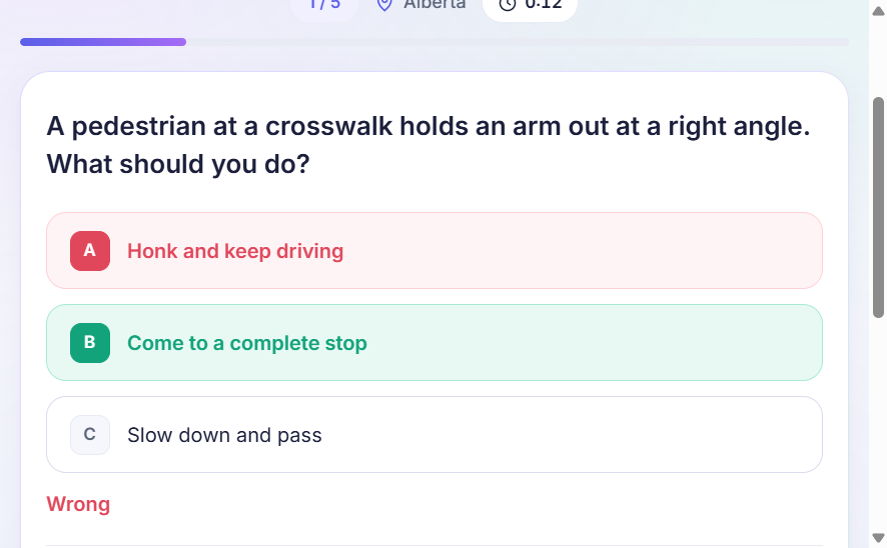
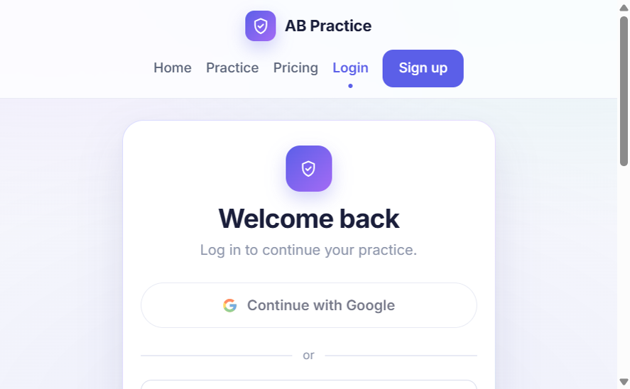
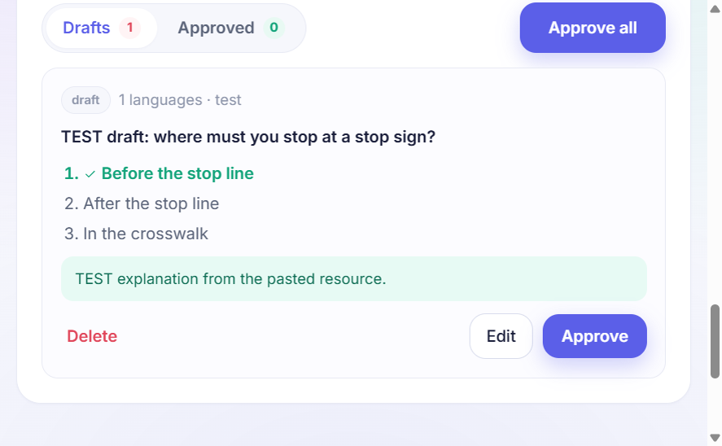

# Road Ready — Driving Theory Practice Exams

[](https://github.com/eskandari-dev/ab-practice/actions/workflows/ci.yml)

A full-stack web app for practising driving knowledge tests. Users choose their country and
region, and every exam follows that region's official format (number of questions, pass mark,
time limit and separately-passed sections). Admins create new questions with AI from official
handbooks, review them, and publish them.

| Practice | Exam |
| --- | --- |
|  |  |
|  |  |

| Practice | Exam |
| --- | --- |
|  |  |
|  |  |

## Features

- **Region-aware exams.** 28 regions in 6 countries, each with its own rules — for example
  Alberta has 30 questions and 25 correct answers to pass; Ontario has two 20-question parts
  that must each be passed.
- **9 languages** (English, 中文, Español, Français, Deutsch, Português, العربية, فارسی, हिन्दी),
  with right-to-left layout for Arabic and Persian.
- **Exam experience:** timer, keyboard shortcuts, explanations, answer review, progress stats,
  and a "practice my mistakes" mode.
- **Progress page:** pass readiness, score chart, exam history and streaks — saved to the
  account when logged in.
- **Accounts:** email/password and "Continue with Google" (Firebase Authentication), an account
  page to change the password or delete the account, and a login attempt limit.
- **Dark mode** that follows the system setting, with a toggle that is remembered.
- **AI test designer (admin):** upload a PDF/TXT handbook; an LLM (OpenAI or any OpenAI-compatible API such as DeepSeek) writes multilingual questions
  using only facts from the source. Questions stay as drafts until an admin approves them.
- **Payments:** Stripe Checkout with exam packs and a monthly unlimited plan.

## Tech stack

| Part | Tools |
| --- | --- |
| Frontend | React 19, Vite, React Router |
| Backend | Python, FastAPI, PostgreSQL (Neon) or SQLite |
| Integrations | Firebase Authentication (Google sign-in), OpenAI-compatible LLM API (DeepSeek), Stripe |
| Deploy | Docker (one container serves the site and the API) |

## Run locally

Backend (Python 3.11):

```bash
cd backend
python -m venv venv
venv\Scripts\activate          # macOS/Linux: source venv/bin/activate
pip install -r requirements.txt
copy .env.example .env         # then fill in the values you need
uvicorn main:app --reload
```

Frontend (Node 20+):

```bash
cd frontend
npm install
npm run dev
```

Open http://localhost:5173.

Tests (run automatically by GitHub Actions on every push):

```bash
cd backend
python -m unittest discover tests
```

## Deploy

The `Dockerfile` builds the React site and runs FastAPI, which serves the API under `/api` and
the site on every other path (`backend/server.py`). Set `DATABASE_URL` to a Postgres database
(for example a free one from [Neon](https://neon.tech)), or mount a persistent volume at `/data` for
SQLite, and set the other variables from `backend/.env.example` on the host.
`render.yaml` sets this up on [Render](https://render.com)'s free plan as a Blueprint, and the
`Keep awake` GitHub workflow stops the free instance from sleeping.

## Project structure

```
backend/
  main.py        API: auth, exams, payments, admin
  rules.py       official exam rules for each region
  ai.py          AI question generator
  server.py      production entry point (API + site)
  tests/         API tests
frontend/src/
  pages/         Home, Practice, Admin, Login, Pricing, ...
  i18n/          translations for 9 languages
```
